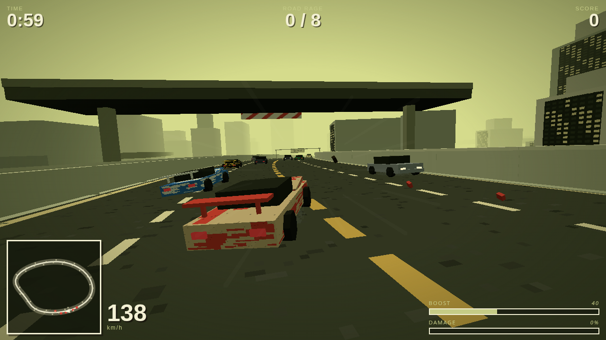

# Martian Motor Mayhem

A lightweight, in-browser arcade racer. The mode in this build is **Road Rage**: a third-person chase down an elevated city freeway, in a chunky low-poly look. Shunt rival cars into the concrete or into traffic, and clear a takedown target before the clock or the car gives out.

Everything on screen is built in code. Cars, the road, buildings, overpasses, textures, and sounds are procedural. [three.js](https://threejs.org/) r170 is vendored (MIT) in `vendor/three.module.js`. There is no build step.



## Run it

From this folder:

```bash
python3 -m http.server 8647
```

Open http://localhost:8647

The page is an ES module, so it needs a local server. Opening `index.html` as a file will not load the modules.

## Controls

| Key | Action |
| --- | --- |
| W | Throttle |
| S | Brake / reverse |
| A | Steer left |
| D | Steer right |
| Q | Drift left. The rear steps out, grip drops, and the boost meter fills. |
| E | Drift right. Same as Q, the other way. |
| Space | Boost, while the meter has charge |
| F | Fullscreen |
| Esc | Pause. Resume or Quit. Quit returns to the start menu. |

Enter also starts a run from the menu or the results screen.

## Road Rage rules

- The clock starts at 60 seconds. The target is 8 takedowns.
- Rivals race with you. Ram them into a barrier, into traffic, or just break them apart to score a takedown.
- Each takedown before the target adds 10 seconds. Once the target is met, the clock stops getting gifts. Keep driving for bonus score until time runs out or the car is wrecked.
- Clearing the target is a win, even if the bonus run ends in a wreck. Running out of time or totaling the car before 8 is a loss.
- Two-way traffic. A head-on with traffic totals the car. A sideswipe or a rear-end launches that car and fills the boost meter.
- Rival hits and wall hits damage the hull. The damage bar fills as the car comes apart. Empty hull is game over.
- Rival contact is heavy: you scrub speed and take damage, but those cars stay on the road. Traffic bumps are the wild ones. They pop, spin, and leave the lane.
- Holding a drift slides the car at an angle, scrubs a little speed, lays skid marks, and fills the boost meter. Let go and the tires grab again.

## Limits

- One event and one circuit. No campaign, no touch controls, no networked race.
- Takedowns get a slow-motion beat, a flash, and a callout, not a replay camera.
- Damage is the hull bar, darkened paint, and a few scrap bits, not a crumple model.
- Car hits use two spheres along the body, so a glance can feel a little round.
- Sound is synthesized in the browser. It starts after the first click or key press.
